Modern Morrow
=============

*A controller-first interface for OpenMW.*

Modern Morrow is a fork of [OpenMW](https://gitlab.com/OpenMW/openmw). It replaces the game's whole user interface with a modern one built for a controller, a TV and handhelds such as the Steam Deck. The game itself is unchanged: the same rules, quests and saves, with new screens on top.

Morrowind's menus were made for a mouse on a small monitor. They are grids of icons with the information hidden in tooltips, in small windows that overlap. This fork turns each of them into a full screen or panel in one consistent style: lists that say what each thing is, a details panel that compares it with what you have, large text that reads from the couch, and button hints for the controller in your hands.

**Modern Morrow was vibe coded.** A person directed the work, played the game, and reviewed every screen in screenshots and in play. Claude wrote nearly all of the code, the tests and the design notes. It is an experiment, and it has not been reviewed by the OpenMW developers. Expect rough edges.

Screenshots
-----------

### The HUD gets out of the way

**Exploring**

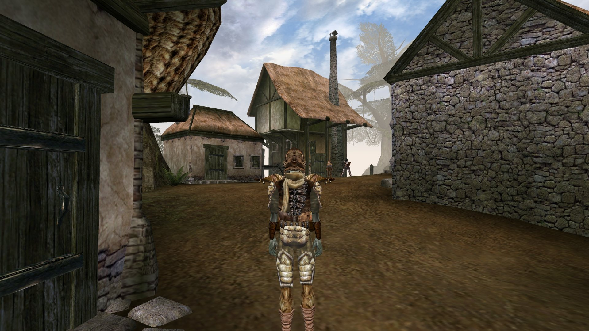

**When it matters**

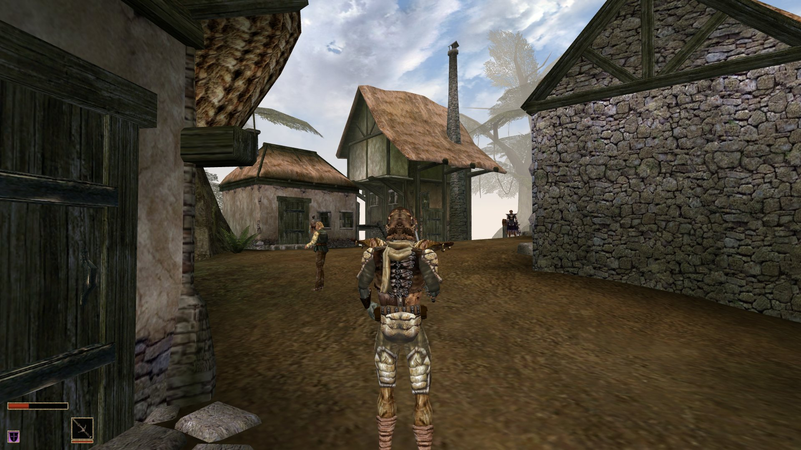

These show the bottom-left corner of the screen, where the HUD sits. The HUD hides itself until there is something worth knowing:

- The minimap is gone.
- Health, magicka and fatigue bars fade away when they're full, unless you're in combat.
- Effect icons leave out permanent effects, such as those of your race and birthsign.
- The weapon and spell boxes only show when you ready or change them, or in combat.

### Inventory

**Equipment, by body area**

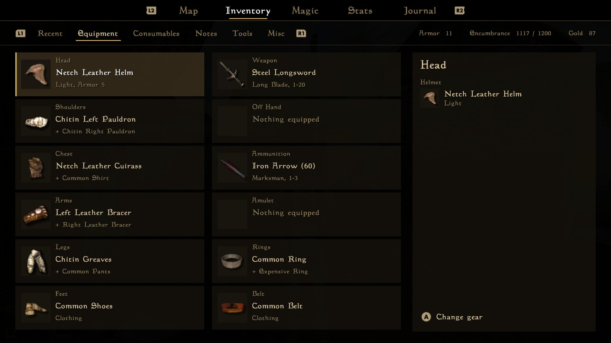

**One area, compared with what you wear**

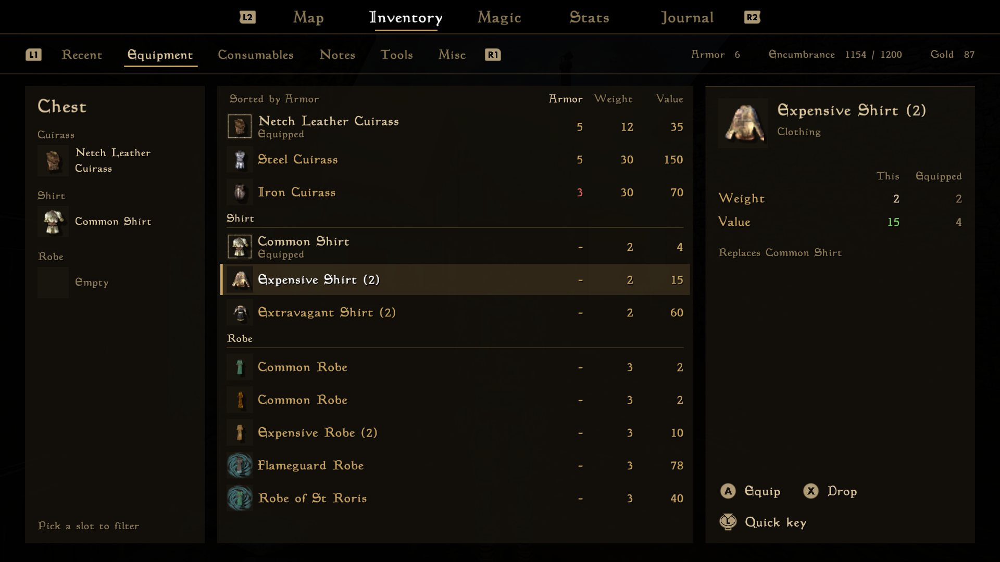

The inventory opens on what you're wearing, one tile per body area. Choosing an area lists everything that fits it, grouped by slot: the chest area has cuirasses, shirts and robes, each under its own header. The stats that matter are columns. Numbers are green where they beat what you have equipped and red where they don't, and the details panel compares the two side by side. Other tabs list recent pickups, consumables grouped by effect, books, tools, and everything else, grouped by kind. The shoulder buttons switch tabs, and the triggers switch between the map, inventory, magic, stats and journal.

### Magic

**What's affecting you**

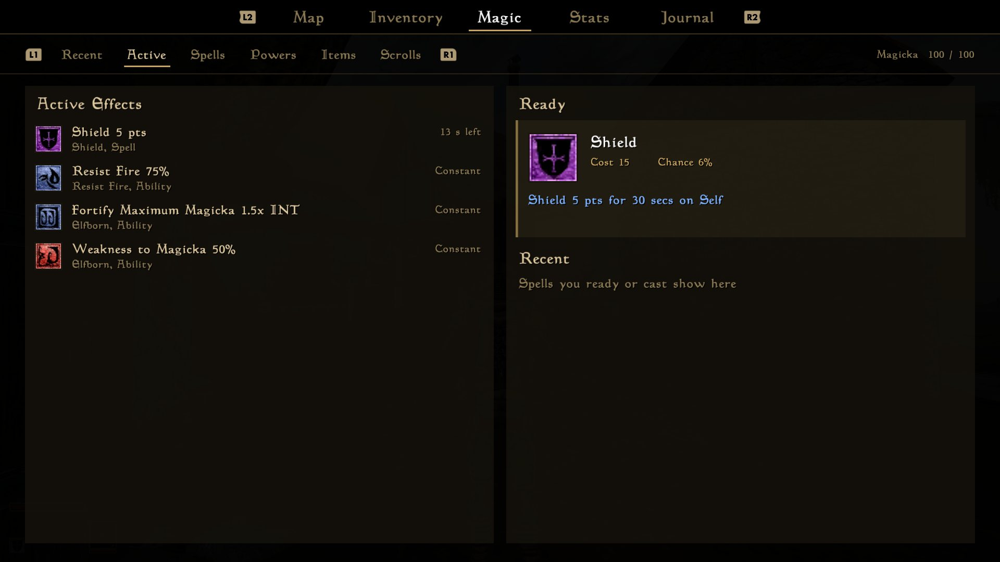

**Every spell, by school**

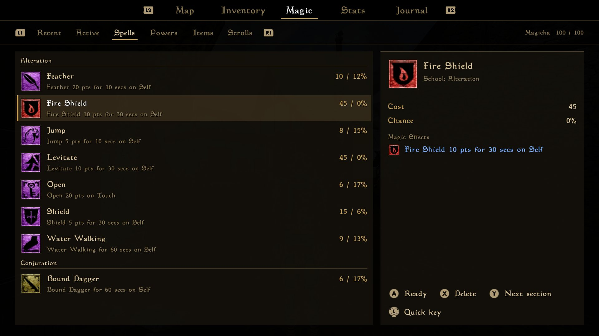

The Active tab shows what's affecting you, how long each effect has left and where it came from, next to the spell that's ready to cast and the ones you used recently. Switching back to a favourite spell takes one press. The other tabs list every spell, power, magic item and scroll, with their effects written out in full. Spells are grouped by school, such as Alteration or Destruction, and Y jumps to the next school.

### Character

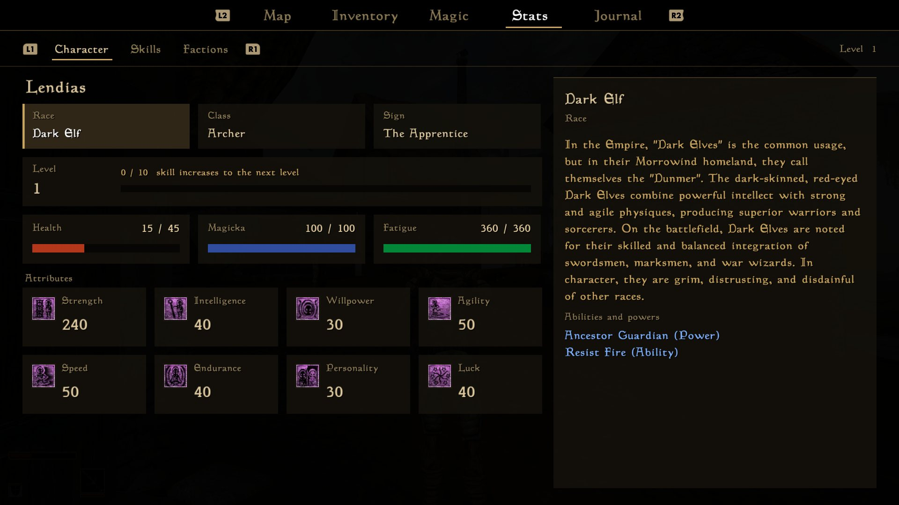

Everything on the stats screen can be highlighted to read what it is and what it does. Each attribute tile shows the bonus it would get at the next level up.

### Journal

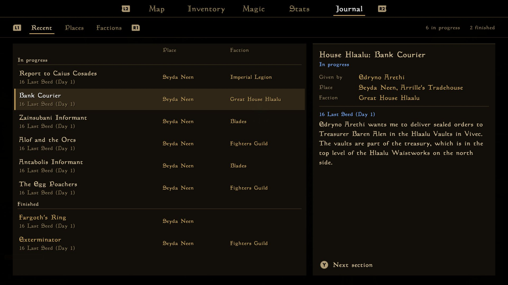

The journal is a list of quests rather than a book. Quests in progress come first, then finished ones, sorted by when they last changed, or grouped by place or by faction. The details show who gave you the quest, where, and every entry, newest first.

### Conversations and trading

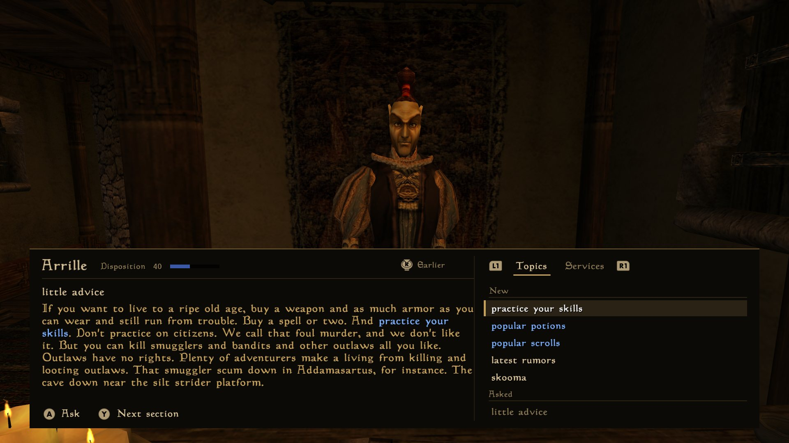

Conversations take a panel along the bottom of the screen. In first person, the camera turns to the face of the person you're talking to, so it sits in view above the panel. New topics come first, and the person's services, such as trading, training or persuasion, have their own tab.

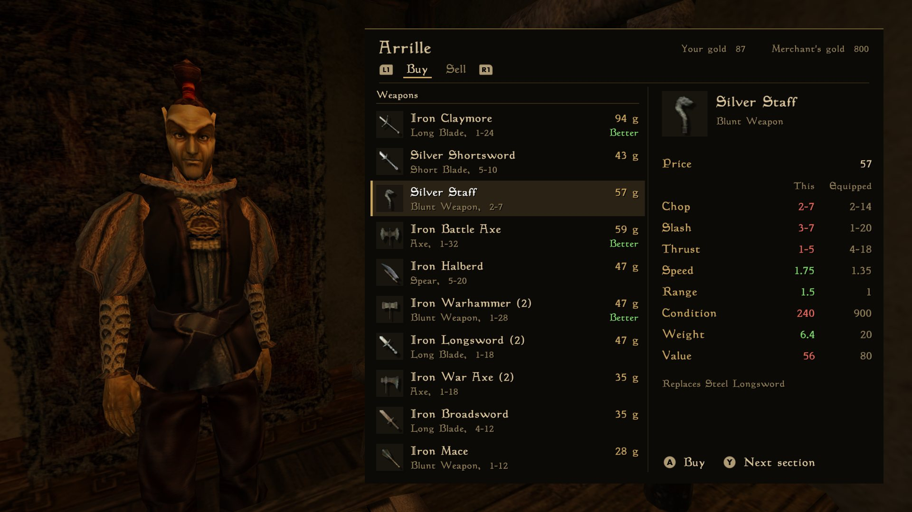

Trading uses the same panel style. Every item shows its price, items better than yours are marked, and the details compare them with what you have.

### Looting

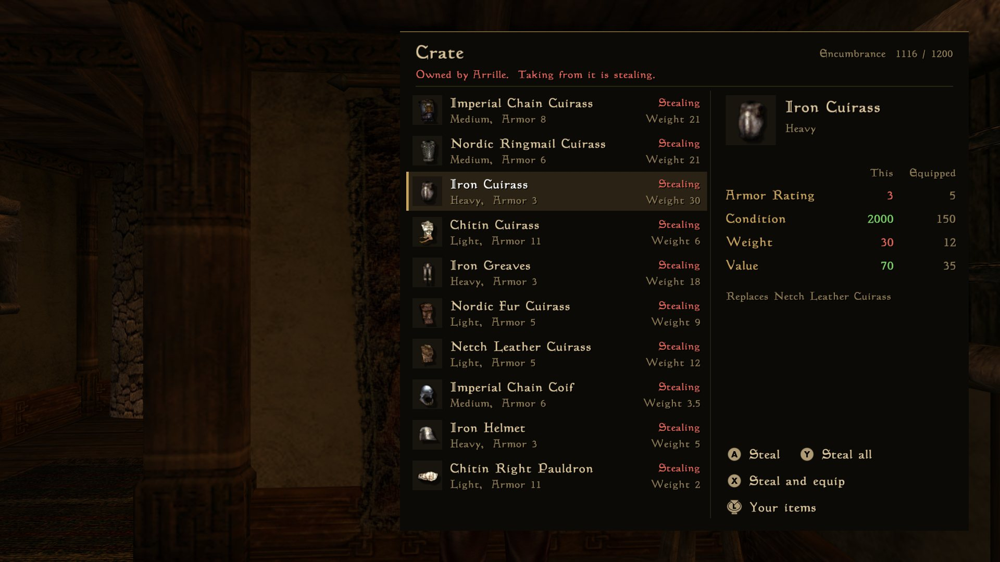

Containers open in a panel beside the world, grouped by kind, with upgrades marked. When the container belongs to someone, the panel says so, and every action is named for what it is: Steal, not Take.

### Crafting

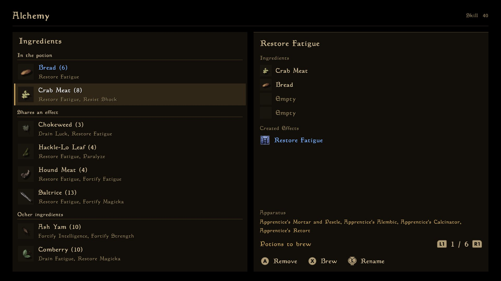

Alchemy lists your ingredients with the effects you know. Once the potion has an ingredient, the list puts the ones that share an effect with it first, so finding a match no longer means opening tooltips one by one.

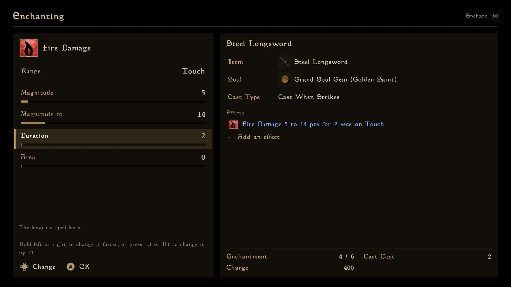

Enchanting and spellmaking show what you're making on the right and what you can pick on the left. Effects are edited in place, and the cost, charge and price update as you change the magnitude or the duration.

### Everything else

The rest of the game has controller screens in the same style too:

- **Quick keys** are on the d-pad: tap a direction for one slot, or hold it for another. Assign them from the inventory or the magic screen, and the HUD briefly shows what you used.
- **Merchant services**: buying spells, training, travel and repair.
- **Rest and wait, and level up.**
- **Books and scrolls**, as one scrolling page.
- **Saving and loading.**
- **Character creation**, with an on-screen keyboard for names, and a full screen for making a custom class.
- **Persuasion**, with the person's disposition and your gold.
- **Repairing and recharging** with your own tools.
- **The options**, as rows a controller can change.
- **Messages** such as "Your spell failed", in large text.

Trying it
---------

You need a copy of Morrowind. Build this fork the same way as OpenMW: see the [OpenMW build instructions](https://wiki.openmw.org/index.php?title=Development_Environment_Setup), or [CLAUDE.md](CLAUDE.md) for notes on building on Windows. Then turn on **Enable Controller Menus** in the launcher's settings, or set this in `settings.cfg`:

```ini
[GUI]
controller menus = true
```

With the setting off, the game uses OpenMW's normal interface. With it on, the new screens only respond to a gamepad for now. Mouse support is planned.

How it's built
--------------

The new screens are drawn in code on top of OpenMW's own windows, which stay hidden and keep doing the work, so the game's rules and checks are unchanged. The design notes for each screen, and a log of the work, are in [ui-rework/](ui-rework/README.md). The project also includes a harness that drives the game with a virtual gamepad and takes screenshots, which is how most of the screens were tested.

About OpenMW
------------

OpenMW is an open-source open-world RPG game engine that supports playing Morrowind by Bethesda Softworks. Everything here builds on the work of the OpenMW team. To play Morrowind on the official engine, or to report bugs in it, go to [openmw.org](https://www.openmw.org) or the [OpenMW repository](https://gitlab.com/OpenMW/openmw). Please don't report bugs from this fork there.

* License: GPLv3 (see [LICENSE](LICENSE) for more information)

Font Licenses:
* DejaVuLGCSansMono.ttf: custom (see [files/data/fonts/DejaVuFontLicense.txt](files/data/fonts/DejaVuFontLicense.txt) for more information)
* DemonicLetters.ttf: SIL Open Font License (see [files/data/fonts/DemonicLettersFontLicense.txt](files/data/fonts/DemonicLettersFontLicense.txt) for more information)
* MysticCards.ttf: SIL Open Font License (see [files/data/fonts/MysticCardsFontLicense.txt](files/data/fonts/MysticCardsFontLicense.txt) for more information)
