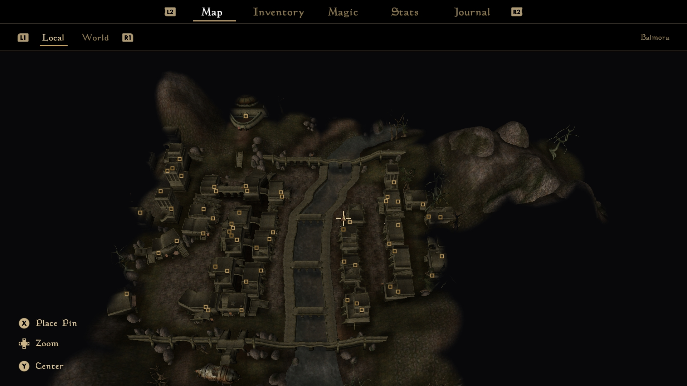

Modern Morrow
=============

*A controller-first interface for OpenMW.*

Modern Morrow replaces the game's whole user interface with a modern one built for controllers, TVs and handhelds. The gameplay and in-game graphics are largely unchanged.

The grid of items has been replaced with lists and tabs. Item names and stats are more easily visible. The local map is fully 3D. Text has been made larger and easier to read.

**Modern Morrow is a vibe coded fork of [OpenMW](https://gitlab.com/OpenMW/openmw).** A human (me) directed the work and made design decisions. Claude wrote all of the code. It is an experiment, and it has not been reviewed by the OpenMW developers. Expect rough edges.

I talked with the OpenMW developers about doing this as an extension, but OpenMW's APIs can't fully replace the user interface yet. Once they finish their Lua work, I will rework this to be a mod.

Screenshots
-----------

### Inventory

**Equipment**

The inventory tab opens directly to show your currently equipped equipment. Each area of the body has one card. Clicking an area drills down into that area (see below). Areas that have new items available are labeled "New", though the screenshot doesn't show that.

**One Equipment Area**

Here we see the Chest area. The chest area has equipment slots for a cuirass, shirt, and robe. Selecting an item shows its stats on the right, compared with your currently equipped item. Green indicates it beats your current equipment, red means it is worse.

### Magic

**Active Effects and Equipped Magic**

The default Magic tab shows your active effects (left column), your equipped magic (upper right), and your recently equipped spells (lower right, empty in the screenshot) so you can switch to a recent spell easily.

**Spell Tab**

The spell tab shows all your spells, grouped by school. Selecting a spell shows its details. Clicking it equips it.

### Character

Everything on the stats screen can be highlighted to read what it is and what it does. Each attribute tile shows the bonus it would get at the next level up.

### Map

The local map is now a 3D view of the world. You can pan (right stick) and zoom (d-pad). Indoor maps are 3D as well, with the ceiling cut off. You can mark locations with X.

### Journal

The journal is a list of quests rather than a book, grouped by pin, active, or finished.

### Conversations and trading

Conversation text is bigger so it's easier to read. Conversation topics are now sorted so unseen topics are at the top (blue first), with already seen topics greyed out below. Services like bartering and training are on a separate tab.

The camera turns to face the NPC as well.

Trading has a panel with a list of items to buy, and a separate tab for items to sell. Items better than yours are marked. The camera also adjusts to face the NPC.

### Looting

Containers show a list of contents, with upgrades and stealing marked.

### HUD

**The HUD hides when it isn't useful**

This shows the bottom-left corner of the screen, where the HUD sits. The HUD components hide themselves unless you're in combat or one of your bars is not full.

Also:
- No minimap on the HUD.
- Permanent active effects are not shown in the HUD.

### Crafting

Alchemy lists your ingredients with the known effects. Once the potion has an ingredient, the list puts the ones that share an effect with it first, so finding a match no longer means opening tooltips one by one.

Enchanting and spellmaking show what you're making on the right and what you can pick on the left. Effects are edited in place, and the cost, charge and price update as you change the magnitude or the duration.

### Everything else

The rest of the game has controller screens in the same style too:

- **Quick keys** are on the d-pad: tap a direction for one slot, or hold it for another. Assign them from the inventory or the magic screen.
- **Merchant services**: buying spells, training, travel and repair.
- **Rest and wait, and level up.**
- **Books and scrolls**, as one scrolling page.
- **Saving and loading.**
- **Character creation**, with an on-screen keyboard for names, and a full screen for making a custom class.
- **Persuasion**, with the person's disposition and your gold.
- **Repairing and recharging** with your own tools.
- **The options**, as rows a controller can change.
- **Messages** such as "Your spell failed", in large text.

Other improvements
------------------

- **The Steam Controller works without Steam.** The game can recognize the new Steam Controller without running it through Steam. This works by upgrading the game to work with SDL3.
- **Automatic full-screen resolution.** The game defaults to windowed fullscreen at the current screen's resolution. No need to configure it.
- **Better settings out of the box.** Several of OpenMW's optional settings are on by default. None of them change the game's rules:
  - Better distant fog: no more hard edge hill clipping in the distance.
  - Enabled water shader.
  - Smoother distant textures (linear mipmaps), so no line shows where a floor turns blurrier.
  - Attacks always use the weapon's most powerful swing.
  - Extra details are visible in the detail view (weapon reach and speed, arrows damage bonus, enchantment chance, effect duration, etc).
  - In third person, swimming aims a little above where you look, so you don't dive by accident.
  - Merchants don't put on the armour and clothing you sell them.
  - Sneak toggles on and off, instead of needing to be held.

- **Simplified Saving.** Quicksave creates a new save each time, with smart removal of old quicksaves: all of the last 10 quicksaves are kept, then fewer the older they get. The game also autosaves after 5 minutes of play without a save.
- **Automatic Game Continue.** Starting the game loads your newest save, skipping the logo video and the main menu. With no saves yet, the main menu shows as usual.
- **Automatic Wizard on Steam Deck.** When you run the AppImage, it will launch the setup wizard if necessary, otherwise it launches the game. This means you don't have to pass command options when setting up the non-steam-game properties.
- **Automatic Update on Steam Deck.** An optional script downloads the newest AppImage each time the game starts, so updating doesn't need a trip to Desktop Mode.
- **Pins on the map.** On the local map, X drops a red pin at the crosshair in the middle of the view.
- **Improved Controller Tutorial Instructions.** On a controller, Morrowind's tutorial messages use the text the game was written with for the Xbox, such as "The LEFT THUMBSTICK moves you".

Optional improvements
---------------------

These options change the gameplay, so they're off by default. Turn them on in the Prefs tab of the options.

- **Run Fatigue.** Walking is annoying with a controller, so this option lets you reduce run fatigue to 50%, 25%, or 0%. It defaults to the vanilla 100%.

Trying it
---------

> [!NOTE]
> **Modern Morrow keeps its saves separate from OpenMW.** Modern Morrow tweaks the save format slightly, so it stores saves in a separate directory from OpenMW. You can use the Load menu in Modern Morrow to import a save from OpenMW, and you can use the Save menu in Modern Morrow to export a save back to OpenMW. To bring over a save from Steam Morrowind, first convert it to an OpenMW save with OpenMW's `openmw-essimporter` tool, and put the result in a character folder in OpenMW's saves folder. Then import it from the Load menu. The converted save keeps your quest progress, but not your journal entries. Saves can't go back to Steam Morrowind. Note, you will need OpenMW 0.52 or above.

You need a copy of Morrowind. The [Releases page](https://github.com/DurhamG/modern-morrow/releases) has a Windows installer, a Windows zip, a Linux AppImage and an Android APK. To build this fork yourself, build it the same way as OpenMW: see the [OpenMW build instructions](https://wiki.openmw.org/index.php?title=Development_Environment_Setup), or [CLAUDE.md](CLAUDE.md) for notes on building on Windows.

The new screens are on by default. They're made for a gamepad, but they kinda work with mouse and keyboard.

Modern Morrow keeps its settings and saves apart from OpenMW's: in `Documents/My Games/Modern Morrow` on Windows, and in `~/.config/modern-morrow` and `~/.local/share/modern-morrow` on Linux. To bring over an existing OpenMW setup and its saves, copy OpenMW's folders there.

Steam Deck and Steam Machine
----------------------------

The AppImage is a Linux program, so it runs directly on SteamOS, without Proton. These steps are the same on a Steam Deck and a Steam Machine.

1. **Install Morrowind in Steam.** Install The Elder Scrolls III: Morrowind from your library.
2. **Switch to Desktop Mode.** Press the Steam button, choose Power, then Switch to Desktop.
3. **Download Modern Morrow.** Make a folder for it somewhere. In a web browser, open the [Releases page](https://github.com/DurhamG/modern-morrow/releases) and download one of these two files from the latest release into your folder:
   - **`ModernMorrow-AutoUpdate.sh`, to keep the game up to date by itself.** Each time it starts, this script checks GitHub for a newer build, downloads it if there is one and starts the game. Without an internet connection, it starts the copy it already has. It keeps the AppImage in its folder, as `ModernMorrow.AppImage`.
   - **`ModernMorrow-...-Linux-x86_64.AppImage`, to update by hand.** To update it later, download the new AppImage in Desktop Mode and point the Steam shortcut at it.
4. **Make it executable.** In the Dolphin file manager, right-click the file you downloaded, choose Properties, then Permissions, and tick **Allow executing file as program** or **Is executable**.
5. **Add it to Steam.** Open Steam, choose Games, then **Add a Non-Steam Game to My Library**. Choose Browse, set the file type to All Files so that the file shows, and add the file you downloaded. Leave all the other options alone.
6. **Start it once to set up the game data.** Still in Desktop Mode, start Modern Morrow from your Steam library. With the update script, this first start needs an internet connection. Then the setup wizard opens. Choose to use an existing installation. The wizard finds Morrowind on the internal drive by itself. If Morrowind is on a microSD card, browse to the `steamapps/common/Morrowind` folder on the card instead. When the wizard finishes, the game starts.
7. **Play in Game Mode.** Return to Gaming Mode and start Modern Morrow from your library. From now on, it goes straight into the game.

Start Modern Morrow from Steam rather than by double-clicking it in Dolphin. Dolphin refuses to start some AppImages, even when they're executable.

If the autoupdater isn't working, `ModernMorrow-AutoUpdate.log`, in the script's folder, says what the last check did. To open the launcher for mods and settings, set the shortcut's launch options to `--launcher` for one start. `--wizard` runs the setup wizard again. The settings and saves are in `~/.config/modern-morrow` and `~/.local/share/modern-morrow`.

Android
-------

The Android version is an early test. It is for phones, tablets and handhelds, played with a gamepad or with touch gestures. With touch, there are no buttons on the screen: the left thumb walks and the right thumb looks and acts, swiping in from the left edge opens the inventory, and swiping in from the right edge picks the mode, such as attack or magic. The corners quicksave (top left), quickload (hold top right) and sneak (bottom right).

1. **Install the APK.** Download `ModernMorrow-...-Android-arm64.apk` from the [Releases page](https://github.com/DurhamG/modern-morrow/releases) on the device and open it. Android asks you to allow installing apps from your browser or file manager.
2. **Copy the game data.** Copy Morrowind's `Data Files` folder from a PC install into a `Morrowind` folder at the top of the device's storage, so that `Morrowind/Data Files/Morrowind.esm` is there.
3. **Start Modern Morrow.** The first time, it asks for access to all files, so it can read the `Morrowind` folder. Allow it, then return to the app.

The settings, saves and logs are in `Android/data/io.github.durhamg.modernmorrow/files`. Uninstalling the app deletes that folder, saves included.

How it's built
--------------

The new screens are drawn in code on top of OpenMW's own windows, which stay hidden and keep doing the work, so the game's rules and checks are unchanged. The design notes for each screen, and a log of the work, are in [ui-rework/](ui-rework/README.md). The project also includes a harness that drives the game with a virtual gamepad and takes screenshots, which is how most of the screens were tested.

About OpenMW
------------

OpenMW is an open-source open-world RPG game engine that supports playing Morrowind by Bethesda Softworks. Everything here builds on the work of the OpenMW team. To play Morrowind on the official engine, or to report bugs in it, go to [openmw.org](https://www.openmw.org) or the [OpenMW repository](https://gitlab.com/OpenMW/openmw). Please don't report bugs from this fork there.

* License: GPLv3 (see [LICENSE](LICENSE) for more information)

Font Licenses:
* DejaVuLGCSansMono.ttf: custom (see [files/data/fonts/DejaVuFontLicense.txt](files/data/fonts/DejaVuFontLicense.txt) for more information)
* DemonicLetters.ttf: SIL Open Font License (see [files/data/fonts/DemonicLettersFontLicense.txt](files/data/fonts/DemonicLettersFontLicense.txt) for more information)
* MysticCards.ttf: SIL Open Font License (see [files/data/fonts/MysticCardsFontLicense.txt](files/data/fonts/MysticCardsFontLicense.txt) for more information)
